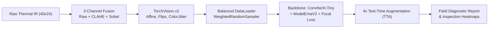
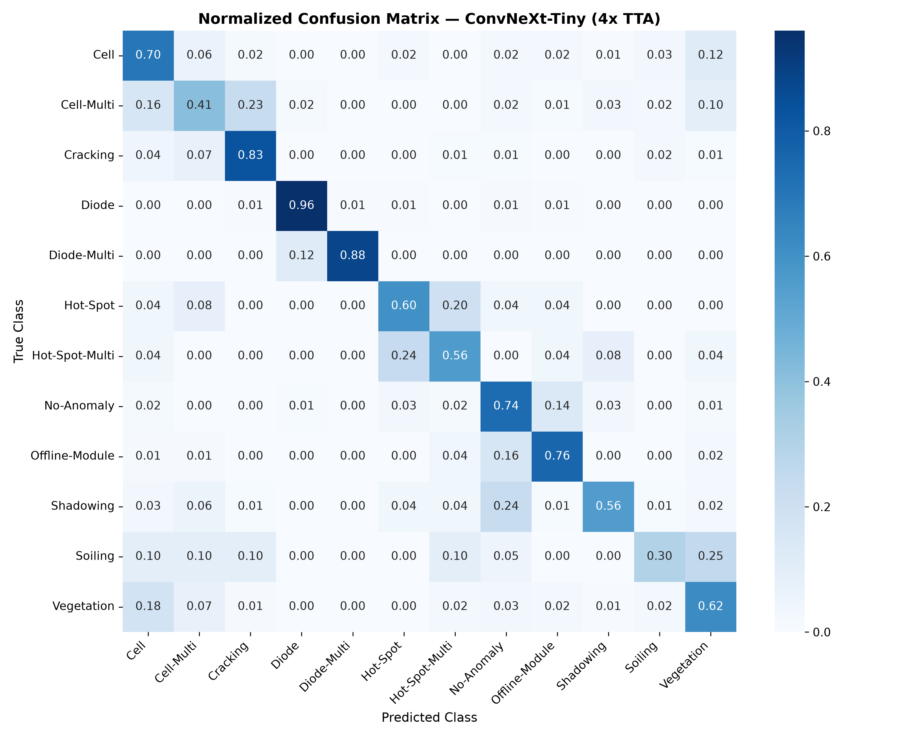
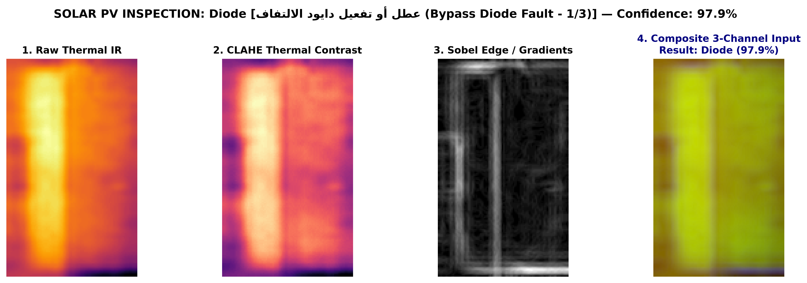
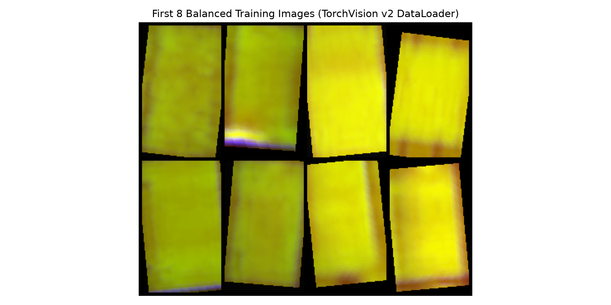
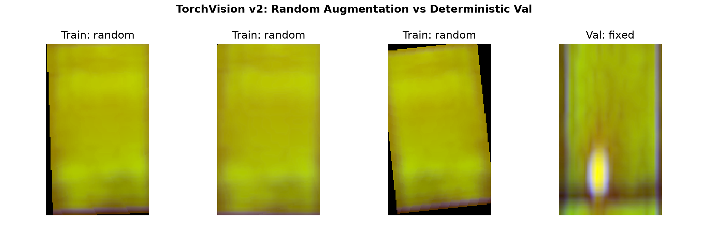

# ☀️ Solar Photovoltaic Fault Detection using TorchVision v2 & ConvNeXt
## نظام كشف وتشخيص أعطال الألواح الشمسية الكهروضوئية بالرؤية الحاسوبية والتعلم العميق

[](https://www.python.org/)
[](https://pytorch.org/)
[](https://pytorch.org/vision/stable/transforms.html)
[](https://github.com/huggingface/pytorch-image-models)
[](LICENSE)

نظام متكامل قائم على أحدث تقنيات الرؤية الحاسوبية (**Computer Vision**) وهندسة خطوط البيانات الحديثة (**TorchVision v2**) لتحليل الصور الحرارية بالأشعة تحت الحمراء (**Infrared Thermography**) وتصنيف 12 صنفاً من الأعطال والظواهر التشغيلية بدقة متناهية مع معالجة اختلال البيانات والاستدلال المعزز (**4x TTA**).

---

## 📌 جدول المحتويات (Table of Contents)
- [نظرة عامة (Overview)](#-نظرة-عامة-overview)
- [المعمارية الهندسية وخط الأنابيب (Pipeline Architecture)](#-المعمارية-الهندسية-وخط-الأنابيب-pipeline-architecture)
- [أصناف الأعطال الـ 12 (Defect Classes)](#-أصناف-الأعطال-الـ-12-defect-classes)
- [النتائج ومصفوفة الارتباك (Benchmark Results)](#-النتائج-ومصفوفة-الارتباك-benchmark-results)
- [معرض الفحص والتحليل البصري (Visual Gallery)](#-معرض-الفحص-والتحليل-البصري-visual-gallery)
- [هيكل المشروع (Repository Structure)](#-هيكل-المشروع-repository-structure)
- [التثبيت والتشغيل السريع (Quick Start)](#-التثبيت-والتشغيل-السريع-quick-start)
- [رخصة الاستخدام (License)](#-رخصة-الاستخدام-license)

---

## 🔬 نظرة عامة (Overview)

تُعد الفحوصات الحرارية بالأشعة تحت الحمراء (IRT) الركيزة الأساسية لصيانة مزارع ومحطات الطاقة الشمسية. تقدم هذه الحزمة خط أنابيب هندسي متكامل يتعامل مع التحديات الحقيقية للبيانات:
1. **الأبعاد المنخفضة للصور الحرارية ($40 \times 24$ بكسل).**
2. **تحويل القناة الأحادية إلى تمثيل طيفي ثلاثي (Raw + CLAHE Contrast + Sobel Gradients).**
3. **الاختلال الحاد بين الفئات (Class Imbalance بنسبة تصل إلى 57:1).**
4. **تطبيق معمارية ConvNeXt الحديثة مع تسريع الاستدلال عبر 4x TTA.**

---

## 🏗️ المعمارية الهندسية وخط الأنابيب (Pipeline Architecture)



### الميزات التقنية للخط الهندسي:
* **معالجة القنوات الثلاثية (`preprocess_thermal_3ch`):** دمج الصورة الأصلية مع تعزيز التباين التكيفي (**CLAHE**) وتدرجات سوبل (**Sobel Gradients**) لالتقاط الشقوق الدقيقة والبقع الساخنة.
* **موازنة العينات الذكية (`WeightedRandomSampler`):** تطبيق دالة ترجيح بأس $N^{-0.55}$ لرفع تمثيل الأعطال النادرة (مثل عطل الدايودات المتعددة والاتساخ) دون إفراط في التكرار.
* **دالة الخسارة الموزونة (`WeightedFocalLoss`):** تركيز التعلم على العينات الصعبة وإخماد مساهمة العينات السهلة مع تنعيم التسميات (`Label Smoothing 0.05`).
* **استقرار المعاملات (`ModelEmaV2`):** استخدام المتوسط المتحرك الأسي للمعاملات (Decay: 0.995) لضمان أعلى تعميم واستقرار أمام الضوضاء الحرارية.
* **الاستدلال المعزز بأربع تحويلات (`4x TTA`):** دمج التنبؤات عبر الانعكاسات الأفقية والرأسية لرفع الثقة والحد من التشتت.

---

## 📋 أصناف الأعطال الـ 12 (Defect Classes)

| م | صنف العطل (Class) | التوصيف الفني بالعربية | النمط الحراري الفيزيائي |
|---|---|---|---|
| 1 | **Diode** | عطل دايود الالتفاف (1/3 اللوح) | تسخين كامل لثلث مساحة اللوح الشمسي |
| 2 | **Diode-Multi** | عطل دايودات الالتفاف المتعددة (2/3) | تسخين كامل لثلثي مساحة اللوح الشمسي |
| 3 | **Cracking** | تشققات وتصدعات الخلايا | خطوط وتعرجات حرارية ناتجة عن كسر السطح |
| 4 | **Cell** | بقعة ساخنة بخلايا مفردة | خلية مربعة واحدة مرتفعة الحرارة |
| 5 | **Cell-Multi** | بقع ساخنة بخلايا متعددة | عدة خلايا متفرقة شديدة السخونة |
| 6 | **Hot-Spot** | نقطة ساخنة في لوح رقيق (Thin-Film) | بقعة حرارية مركزة في تقنية الألواح الرقيقة |
| 7 | **Hot-Spot-Multi** | نقاط ساخنة رقيقة متعددة | نقاط حرارية شاذة متعددة |
| 8 | **Offline-Module** | لوح مفصول أو معطل بالكامل | اللوح بأكمله شديد السخونة لعدم تفريغ التيار |
| 9 | **Shadowing** | حجب وظلال جزئية | تدرجات ناتجة عن أشجار أو مبانٍ مجاورة |
| 10 | **Vegetation** | حجب نباتي (أعشاب نامية) | تشوهات حرارية عند الأطراف السفلية |
| 11 | **Soiling** | غبار وتلوث سطحي | انخفاض وتفاوت كفاءة التبريد نتيجة الأتربة |
| 12 | **No-Anomaly** | لوح سليم وطبيعي | حرارة متجانسة وخالية من أي شذوذ |

---

## 📊 النتائج ومصفوفة الارتباك (Benchmark Results)

تم تقييم النموذج المحفوظ على مجموعة الاختبار المستقلة بالكامل (**2,000 صورة**) باستخدام تقنية **4x TTA**:

| المقياس الهندسي (Metric) | النتيجة المحققة (Score) |
|---|:---:|
| **دقة الاختبار الإجمالية (Test Accuracy)** | **`70.90%`** |
| **الدقة المتوازنة (Balanced Accuracy)** | **`65.99%`** |
| **معدل Macro F1-Score** | **`59.39%`** |
| **معدل Weighted F1-Score** | **`72.68%`** |

### أبرز معدلات الدقة عبر الفئات:
* **عطل الدايود (Diode Fault):** نسبة استدعاء **`96.0%`**، ودقة **`90.6%`**، و **`F1-Score: 93.2%`** 🌟.
* **عطل الدايودات المتعددة (Diode-Multi):** نسبة استدعاء **`88.2%`**، و **`F1-Score: 85.7%`** 🌟.
* **تشققات الخلايا (Cracking):** نسبة استدعاء **`83.0%`**، و **`F1-Score: 73.9%`**.
* **الألواح السليمة (No-Anomaly):** دقة تنبؤ **`93.1%`**، و **`F1-Score: 82.3%`**.
* **البقع الساخنة (Cell Defect):** نسبة استدعاء **`70.1%`**، و **`F1-Score: 65.8%`**.

---

## 🖼️ معرض الفحص والتحليل البصري (Visual Gallery)

### 1. مصفوفة الارتباك المعيارية (Normalized Confusion Matrix)


### 2. تقرير الفحص الميداني واستخراج القنوات الثلاث (Inspection Report)


### 3. دفعة البيانات المتوازنة عبر TorchVision v2 (DataLoader Batch Preview)


### 4. معاينة تحويلات التدريب العشوائية مقابل التحقق الثابت (Augmentations Preview)


---

## 📁 هيكل المشروع (Repository Structure)

```text
├── InfraredSolarModules_TorchVisionV2.py  # خط التدريب الكامل وبناء البيانات واختبارات القبول
├── predict_pipeline.py                    # خط أنابيب الاستدلال وتشخيص أي لوح جديد وإصدار التقرير
├── evaluate_convnext.py                   # كود تقييم النموذج على مجموعة الاختبار ومصفوفة الارتباك
├── requirements.txt                       # متطلبات وحزم المشروع
├── .gitignore                             # ملف تجاهل الحزم والبيانات الضخمة
├── README.md                              # التوثيق الهندسي الشامل
├── confusion_matrix_convnext.png          # رسم مصفوفة الارتباك لنموذج ConvNeXt
├── inspection_report.png                  # عينة لتقرير التشخيص الفني البصري
├── preview_batch.png                      # معاينة أول 8 صور من الدفعة المتوازنة
└── preview_augmentations.png              # مقارنة التحويلات العشوائية والثابتة
```

---

## 🚀 التثبيت والتشغيل السريع (Quick Start)

### 1. استنساخ المشروع وتثبيت المتطلبات:
```bash
git clone https://github.com/AbdulrahmanAlmenajer/Solar-PV-Fault-Detection.git
cd Solar-PV-Fault-Detection
pip install -r requirements.txt
```

### 2. تشخيص أي صورة لوح شمسي جديدة (Inference):
```bash
python predict_pipeline.py --image "path/to/solar_module.jpg" --ckpt "best_convnext.pth"
```

### 3. تشغيل تقييم النموذج ومصفوفة الارتباك (Evaluation):
```bash
python evaluate_convnext.py
```

### 4. إعادة تدريب النماذج (Training Pipeline):
```bash
python InfraredSolarModules_TorchVisionV2.py --epochs 12 --batch_size 64
```

---

## 📜 رخصة الاستخدام (License)
هذا المشروع مرخص تحت رخصة **MIT License** — راجع ملف [LICENSE](LICENSE) لمزيد من التفاصيل.
